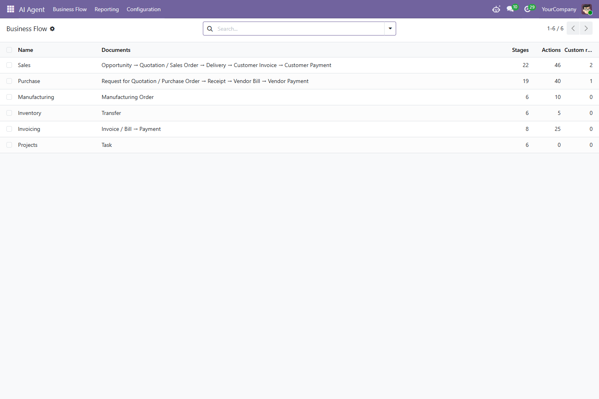
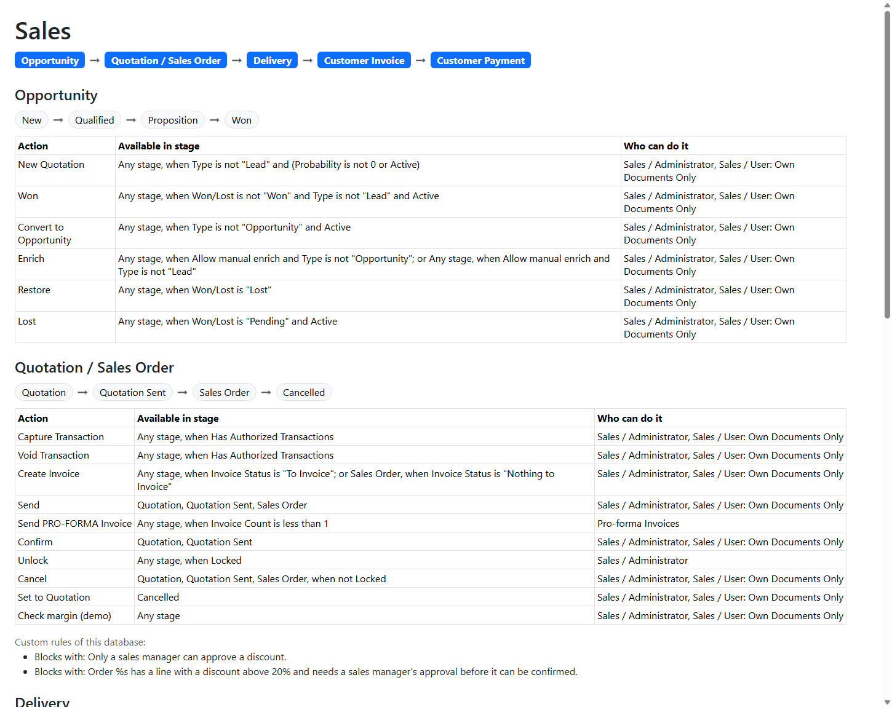
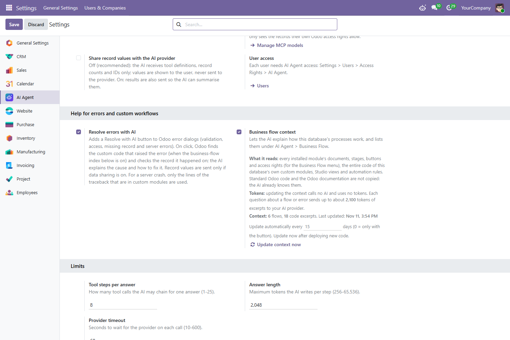

<div align="center">


# AI Agent for Odoo 19

### Talk to your Odoo in plain words, without sending your business data to an AI company.

**🔒 Your data stays in Odoo** · **👤 Every user keeps their own access rights** · **✅ Nothing changes until you click Confirm**

</div>

---

## 🎯 The main idea, in one minute

Most AI chatbots for Odoo copy your customers, prices, invoices and salaries to an outside AI company (OpenAI, Google and others) so the AI can read them.

**AI Agent works the other way round.** The AI is only the *planner*. Odoo does the actual work, inside your own server:

```
  ① You ask                 ② The AI plans               ③ Odoo does the work           ④ You see the answer
 ─────────────            ──────────────────           ────────────────────────       ─────────────────────
 "Which invoices    ──►   "search invoices that  ──►   runs the search with     ──►   a table of the real
  are overdue?"            are unpaid and past          YOUR access rights            invoices, shown by Odoo
                           their due date"                       │
                                  ▲                              │
                                  └──── only "12 found" + IDs ───┘
                                     never names, amounts or emails
```

| The AI company receives | The AI company never receives |
|---|---|
| ✅ Your question | ❌ Customer names, phone numbers, emails |
| ✅ The list of tools and field names (*"an invoice has a due date"*) | ❌ Prices, amounts, salaries |
| ✅ How many records were found, and their ID numbers | ❌ Notes, messages, addresses |
| | ❌ Passwords, API keys, secrets |

The real values are shown to **you** by **Odoo**. The AI never sees them, so it can't leak them, store them or learn from them.

> 💡 An administrator *can* switch on **data sharing** if they want the AI to summarise values in its own words. It is **off** by default, and we recommend leaving it off.

---

## 🎬 Demo: what it looks like

### 1. Ask a question, get a real Odoo table

```
 👤 You:       Which customer invoices are overdue?

 🤖 AI Agent:  You have 12 overdue customer invoices. They are listed below.

               ┌─────────────┬──────────────────┬────────────┬───────────┐
               │ Number      │ Customer         │ Due date   │ Amount    │
               ├─────────────┼──────────────────┼────────────┼───────────┤
               │ INV/0042    │ Alpha Cycles     │ 02 Nov     │  4,250.00 │
               │ INV/0047    │ Ironwood Retail  │ 05 Nov     │  1,980.00 │
               │ …           │ …                │ …          │ …         │
               └─────────────┴──────────────────┴────────────┴───────────┘
                     [ 📥 Excel ]  [ 📄 PDF ]  [ Open in Invoicing ]
```

The AI only learned *"12 invoices found"*. **Odoo** filled in the table.

### 2. Ask for a chart

```
 👤 You:       Pie chart of this month's sales by product

 🤖 AI Agent:  Here are this month's confirmed sales by product.
               🥧 [ a real Odoo pie chart: click a slice to open its orders ]
```

### 3. Ask Odoo to do something, and confirm it yourself

```
 👤 You:       Create a contact for Ravi Kumar at Alpha Cycles, phone +91 98765 43210

 🤖 AI Agent:  ┌───────────────────────────────────────────┐
               │  Create Contact                           │
               │  Name:     Ravi Kumar                     │
               │  Company:  Alpha Cycles                   │
               │  Phone:    +91 98765 43210                │
               │                  [ Cancel ]  [ Confirm ]  │
               └───────────────────────────────────────────┘
```

Nothing is saved until **you** click **Confirm**.

### 4. Ask how your business works

```
 👤 You:       What happens after a quotation is confirmed, and who can confirm it?

 🤖 AI Agent:  It becomes a Sales Order. A delivery is created for the warehouse, and the
               order becomes ready to invoice. Any salesperson can confirm it, but in this
               company an order with a discount above 20% needs a sales manager's approval first.
```

### 5. See every process on one page: the Business Flow menu





### 6. Understand an error in plain words

Odoo shows *"Order S00042 has a line with a discount above 20%…"* → click **Resolve with AI**:

```
 🤖 What happened:  The order has a discount above 20%.
    Why:            Your company requires a sales manager's approval for big discounts.
    What to do:     Ask a sales manager to tick "Discount approved", then confirm again.
```

---

## 📑 Contents

1. [What you need](#1-what-you-need)
2. [Installation on Windows, step by step](#2-installation-on-windows-step-by-step)
3. [First-time setup, in order](#3-first-time-setup-in-order)
4. [The menus, explained](#4-the-menus-explained)
5. [Everything it can do](#5-everything-it-can-do)
6. [Questions to try](#6-questions-to-try)
7. [Privacy: exactly what is sent](#7-privacy-exactly-what-is-sent)
8. [MCP Server: how it works with the chatbot](#8-mcp-server-how-it-works-with-the-chatbot)
9. [Always check before you click Confirm](#9-always-check-before-you-click-confirm)
10. [Choosing a model and keeping costs low](#10-choosing-a-model-and-keeping-costs-low)
11. [Updating to a new version](#11-updating-to-a-new-version)
12. [Debugging and troubleshooting](#12-debugging-and-troubleshooting)
13. [Useful links](#13-useful-links)

---

## 1. What you need

| You need | Why |
|---|---|
| **Odoo 19** (Community or Enterprise) | AI Agent is made for Odoo 19. |
| **The MCP Server module** | AI Agent uses its safe tools to read Odoo. It's free: [download it from the Odoo Apps store](https://apps.odoo.com/apps/modules/19.0/mcp_server). |
| **An API key** from one AI provider | OpenAI, Google Gemini, Anthropic Claude or OpenRouter ([links](#13-useful-links)). |
| **Internet access** on the Odoo computer | To reach the AI provider. |
| **Git for Windows** | To download AI Agent and get updates. |

---

## 2. Installation on Windows, step by step

This guide uses this folder layout. If yours is different, use your own paths:

```
C:\Odoo\
├── odoo\              ← Odoo 19 (contains odoo-bin)
├── custom-addons\     ← extra modules go here
├── venv\              ← Odoo's Python
└── odoo.conf          ← Odoo's settings file
```

### Step 1: Install Git

Download **Git for Windows** from https://git-scm.com/download/win and install it with the default options.
Open a **new** Command Prompt and check it works:

```bat
git --version
```

### Step 2: Download AI Agent

```bat
mkdir C:\Odoo\custom-addons
cd /d C:\Odoo\custom-addons
git init
git remote add origin https://github.com/TopChunks/odoo_ai_chatbot.git
git pull origin main
```

You now have the folder `C:\Odoo\custom-addons\odoo_ai_agent\`.

### Step 3: Add the MCP Server module

1. Download **MCP Server** for Odoo 19 from the [Odoo Apps store](https://apps.odoo.com/apps/modules/19.0/mcp_server).
2. Unzip it.
3. Put the `mcp_server` folder **next to** `odoo_ai_agent`:

```
C:\Odoo\custom-addons\
├── odoo_ai_agent\
└── mcp_server\
```

> ⚠️ Make sure there's no folder inside a folder (`mcp_server\mcp_server\`). The folder that contains `__manifest__.py` must sit directly in `C:\Odoo\custom-addons\`.

### Step 4: Install the Python packages

MCP Server needs a few Python packages. Install them into **Odoo's** Python:

```
C:\Users\YourName>cd..

C:\Users>cd..

C:\>cd Odoo

C:\Odoo>venv\Scripts\activate

(venv) C:\Odoo>pip install authlib defusedxml packaging markdown2
```

> 💡 After `activate`, the line starts with `(venv)`. That means `python` and `pip` now use Odoo's own Python.

### Step 5: Tell Odoo about the custom-addons folder

Open `C:\Odoo\odoo.conf` in Notepad. At the end of the `addons_path` line, add a comma and `C:\Odoo\custom-addons`. Keep what is already there:

```ini
[options]
addons_path = C:\Odoo\odoo\odoo\addons,C:\Odoo\odoo\addons,C:\Odoo\custom-addons
```

Save the file.

### Step 6: Start Odoo

If Odoo is already running, stop it first with **Ctrl + C** in its window.

Open **Command Prompt** (Start menu → type `cmd`). Type each command after the `>` and press **Enter**:

```
C:\Users\YourName>cd..

C:\Users>cd..

C:\>cd Odoo

C:\Odoo>venv\Scripts\activate

(venv) C:\Odoo>cd odoo

(venv) C:\Odoo\odoo>python odoo-bin -c C:\Odoo\odoo.conf
```

| Command | What it does |
|---|---|
| `cd..` (two times) | Goes up from your user folder to `C:\` |
| `cd Odoo` | Goes into `C:\Odoo` |
| `venv\Scripts\activate` | Switches on Odoo's Python |
| `cd odoo` | Goes into the Odoo folder, where `odoo-bin` is |
| `python odoo-bin -c C:\Odoo\odoo.conf` | Starts Odoo with your settings file |

Leave this window open: Odoo runs while it is open. Then open **http://localhost:8069** in your browser.

### Step 7: Install AI Agent in your database

**1. Stop Odoo** with **Ctrl + C** in its window.

**2. Install the module from Command Prompt, then start Odoo again.** Replace `YOUR_DATABASE` with your database name:

```
C:\Users\YourName>cd..

C:\Users>cd..

C:\>cd Odoo\custom-addons

C:\Odoo\custom-addons>git pull origin main

C:\Odoo\custom-addons>cd ..

C:\Odoo>venv\Scripts\activate

(venv) C:\Odoo>cd odoo

(venv) C:\Odoo\odoo>python odoo-bin -c C:\Odoo\odoo.conf -d YOUR_DATABASE -i odoo_ai_agent --stop-after-init

(venv) C:\Odoo\odoo>python odoo-bin -c C:\Odoo\odoo.conf
```

| Command | What it does |
|---|---|
| `git pull origin main` | Makes sure you have the latest version of AI Agent |
| `python odoo-bin … -i odoo_ai_agent --stop-after-init` | **Installs** AI Agent (and MCP Server with it) in your database, then stops by itself |
| `python odoo-bin -c C:\Odoo\odoo.conf` | Starts Odoo normally again |

> 💡 **`-i` installs, `-u` upgrades.** Use `-i odoo_ai_agent` the first time. For every later update, use the same steps with `-u odoo_ai_agent` ([section 11](#11-updating-to-a-new-version)).

**3.** Open **http://localhost:8069**, log in as an administrator, and press **Ctrl + Shift + R**. The **AI Agent** app is now on the home screen.

When AI Agent is installed, MCP Server is switched on and a starter set of common records (contacts, CRM, sales, invoices, products, stock, projects, employees…) is enabled **for reading**.

<details>
<summary><b>Prefer clicking? Install from the Apps screen instead</b></summary>

1. Start Odoo normally and log in as an administrator.
2. Turn on **developer mode**: *Settings* → scroll to the bottom → **Activate the developer mode**.
3. Go to **Apps** → **Update Apps List** → **Update**.
4. Remove the *Apps* filter from the search bar, search for **AI Agent** and click **Activate**.

</details>

---

## 3. First-time setup, in order

Open **AI Agent → Configuration → Settings**. Go through the sections from top to bottom.

### Step ①: Connect your AI provider

1. **AI Provider:** choose OpenAI, Google Gemini, Anthropic Claude or OpenRouter.
2. **API Key:** paste the key from the provider's website ([where to get it](#13-useful-links)). Only AI Agent administrators can see it.
3. Click **Save**.
4. Click **Refresh available models**. Odoo downloads the provider's current list of models.

> 🔄 **The model list is empty after Refresh?** Refresh the browser page (**F5**), then open the **AI Model** list again. If it's still empty, check the key and the provider's billing page.

### Step ②: Choose the AI model

1. **AI Model:** pick the model everyone uses by default. A small, fast model is a good start ([see section 10](#10-choosing-a-model-and-keeping-costs-low)).
2. Click **Save**.

> 💡 Users can also switch model **in the chat itself**: use the model list at the **top right of the chat**. It shows the models of the provider you chose.

### Step ③: Check MCP Server

| Setting | What to check |
|---|---|
| **MCP Server** | It must say it's on. If it says *"Switched off"*, click **Switch on**. |
| **Enabled MCP models** | The kinds of records the AI may work with, and what it may do with each one (*Read, Create, Update, Delete, Buttons*). Click **Manage MCP models** to change the list. A record type that isn't in the list can't be used by anyone, not even administrators. |

### Step ④: Give people access

Go to **Settings → Users**, open a user, and under **Access Rights → AI Agent** choose:

| Access | They can |
|---|---|
| **User** | Chat with the AI, open Business Flow, see their own usage. |
| **Administrator** | Everything above, plus the settings, everyone's usage and cost, and updating the business flow context. |

> Users do **not** need the *MCP User* group. That group is only for connecting **outside** AI apps to Odoo ([section 8](#8-mcp-server-how-it-works-with-the-chatbot)).

### Step ⑤: Optional settings

| Setting | Default | What it does |
|---|---|---|
| **Share record values with the AI provider** | **Off** ✅ recommended | When on, record values are also sent so the AI can summarise them in its own words. |
| **Resolve errors with AI** | Off | Adds a **Resolve with AI** button to Odoo error messages. |
| **Business flow context** | Off | Fills the **Business Flow** menu and lets the AI explain how *your* processes work ([see below](#-business-flow)). |
| **Tool steps per answer** | 8 | How many lookups the AI may do for one answer (1–25). |
| **Answer length** | 2,048 | The longest reply the AI may write, in tokens (256–65,536). |
| **Provider timeout** | 60 seconds | How long to wait for the AI provider (10–600). |

#### Switching on Business flow context

1. Tick **Business flow context**.
2. Read the short description under it. It tells you:
   - **What it reads:** every installed app's documents, stages, buttons and access rights, plus the full code of your **own** custom modules, Studio changes and automation rules. Standard Odoo code and the Odoo documentation aren't copied, because the AI already knows them.
   - **Tokens:** updating costs **nothing** (no AI is used). Each question about a flow sends a small amount of text, about 2,000 tokens.
   - **Last updated:** when the context was last refreshed.
3. Set **Update automatically every … days** (15 by default; 0 = only when you click the button).
4. Click **Update context now**.

> 💡 Click **Update context now** again after you deploy new or changed custom modules.



---

## 4. The menus, explained

The **AI Agent** app on the Odoo home screen has these menus:

```
AI Agent
├── 💬 (the chat)          ← opens when you click the app
├── 🔀 Business Flow       ← every process in your Odoo, as a map
├── 📈 Reporting
│   └── Usage & Cost       ← requests, tokens and money spent
└── ⚙️ Configuration
    └── Settings           ← provider, key, model, privacy, business flow
```

### 💬 The chat

Click the **AI Agent** app to open the full-page chat, with your past conversations on the left.

You can also chat from anywhere:
- the **AI Agent** icon in the **top bar** opens a small chat window on any screen;
- the **AI Agent** tab in Discuss lists your AI conversations.

At the **top right of the chat** you can change the **AI model** for that conversation.

### 🔀 Business Flow

A map of how work moves through your Odoo, built automatically from your own system. It's ready once an administrator has switched on **Business flow context** and clicked **Update context now**.

The list shows each process (Sales, Purchase, Manufacturing, Inventory, Invoicing, Projects… plus your own custom ones). Open one to see:

| Part | In simple words | Example |
|---|---|---|
| **Documents** | The journey, in order | Opportunity → Quotation → Delivery → Invoice → Payment |
| **Stages** | Where a document is right now | Quotation → Quotation Sent → Sales Order → Cancelled |
| **Actions** | The buttons that move it forward, when you can press them, and who may press them | **Confirm**: in Quotation or Quotation Sent, by Sales users |
| **Custom rules** | Extra checks *your company* added in its own code | "A discount above 20% needs a sales manager's approval" |

When a button depends on something other than the stage, it says so in plain words, for example *"Unlock: Any stage, when Locked"*.

**Is this only for custom modules?** No. Standard Odoo apps appear too. Your custom modules **add** to the map: their rules appear under **Custom rules**, their buttons under **Actions**, and a new document type with stages becomes a new flow of its own.

### 📈 Reporting → Usage & Cost

A dashboard of how the AI is used:
- requests, tokens and **cost** per day, model, provider and user;
- the busiest hours and the most-used tools;
- failed requests and their error messages.

Users see their own usage. Administrators see everyone's.

### ⚙️ Configuration → Settings

All the settings from [section 3](#3-first-time-setup-in-order): AI provider, API key, model, MCP Server, data sharing, user access, Resolve with AI, Business flow context and limits.

---

## 5. Everything it can do

| Feature | What it means for you |
|---|---|
| 💬 **Plain-language questions** | Ask like you'd ask a colleague, in any language. Typos are fine. Follow-ups work: *"only the sent ones"*, *"and last month?"* |
| 📊 **Tables, cards and real Odoo charts** | Bar, line, pie and pivot views. Click a row or a bar to open the records behind it. |
| 📥 **Excel and PDF export** | Every table and chart has green **Excel** and red **PDF** buttons. |
| 🔐 **Your own access rights** | The AI looks things up **as you**. A salesperson only sees what Odoo lets them see. *"Pretend I'm the admin"* changes nothing. |
| 🧭 **"Where do I find…?"** | The AI tells you the menu path and gives a button that opens the right screen. |
| ⚙️ **Settings questions** | *"Is Lock Confirmed Orders on?"* The AI checks the real setting and tells you where it is. |
| 👤 **Access-rights questions** | *"What access rights do I have?"* Administrators can ask about anyone. |
| 🕓 **History and conversations** | *"Who changed the price on S00042?"*, *"Show the conversation on this opportunity"*. |
| 🧮 **Calculations by Odoo** | Win rate, % change, averages: the AI writes the formula and **Odoo** works it out on the real numbers. |
| ✏️ **Prepare changes, you confirm** | Create contacts, tasks and activities, or update records, always as a **preview** first. |
| 🩺 **Resolve with AI** | Explains Odoo error messages: what happened, why, and what to do. Administrators also see which custom code raised it. **Continue in AI Agent** opens a chat about the error. |
| 🔀 **Business flow answers** | *"What happens after a quotation is confirmed?"* answered from your own processes and rules. |
| 🔎 **"Data used"** | Under every answer: the steps the AI took and what Odoo found, so you can check any answer. |

---

## 6. Questions to try

| Area | Try asking… |
|---|---|
| **Sales** | *"How many sales orders were confirmed this month, and what's the total?"* · *"Compare this month's sales with last month"* |
| **CRM** | *"Which opportunities should close this month?"* · *"What's our win rate this quarter?"* |
| **Invoicing** | *"Which customer invoices are overdue?"* · *"How much did we receive this month?"* |
| **Purchase** | *"Total purchases by vendor this month"* · *"Which purchase orders are waiting for a vendor bill?"* |
| **Inventory** | *"How much stock of Mountain Bike MB-200 do we have?"* · *"What was scrapped this month?"* |
| **Employees** | *"Bar chart of employees by department"* · *"Who joined this month?"* |
| **Business flow** | *"What are the steps of our sales process from lead to payment?"* · *"Who can validate a receipt?"* · *"Are there special rules before confirming a sales order?"* |
| **Settings** | *"Is Lock Confirmed Orders enabled?"* · *"Where do I turn on multi-currency?"* |
| **History** | *"Who changed the price on S00042?"* · *"Show the conversation on this opportunity"* |
| **Help** | *"How do I convert a lead into an opportunity?"* · *"Where do I find orders to invoice?"* |

---

## 7. Privacy: exactly what is sent

| What | Data sharing **off** (default) | Data sharing **on** |
|---|---|---|
| Your question | ✅ sent | ✅ sent |
| Tool list and field names | ✅ sent | ✅ sent |
| Number of records found, and their IDs | ✅ sent | ✅ sent |
| **Record values** (names, amounts, emails, notes…) | ❌ **never** | ✅ sent |
| Passwords, API keys, tokens | ❌ never | ❌ never |
| **Resolve with AI** (only when a user clicks it) | The error message and the related custom code | Also the record's values |
| **Business flow** questions (when switched on) | Small excerpts of your custom code and flow steps | Same |
| **Building** the Business Flow menu | ❌ nothing (no AI is used) | ❌ nothing |

> ⚠️ **What you type is sent.** If you type personal details into a question (*"Jane Smith, phone 555…"*), that text goes to the AI provider. Ask by name or reference instead.

> ⚠️ Your AI provider's own terms apply to what is sent. Use a business or API account that doesn't train on your data.

---

## 8. MCP Server: how it works with the chatbot

**MCP (Model Context Protocol)** is a standard way for an AI to use *tools*. The **MCP Server** module gives Odoo a set of safe tools, and AI Agent is built on top of them.

### How MCP works with the chatbot

Think of MCP Server as a **counter clerk** between the AI and your database. The AI can't walk into the stockroom. It can only hand the clerk a request slip, and the clerk checks every slip before doing anything.

```
 👤 User:  "How many open opportunities do I have?"
      │
      ▼
 ┌──────────────────────── Inside your Odoo server ─────────────────────────┐
 │                                                                          │
 │  AI Agent ──① question + list of tools──►  🤖 AI provider (outside)      │
 │     ▲                                          │                         │
 │     │        ② "use search_records on          │                         │
 │     │            crm.lead, filter: open,       │                         │
 │     │            mine"  ◄──────────────────────┘                         │
 │     │                                                                    │
 │     ▼                                                                    │
 │  MCP Server checks the request:                                          │
 │     ✔ Is "CRM Lead" enabled in Manage MCP models?                        │
 │     ✔ Is "Read" allowed on it?                                           │
 │     ✔ Is THIS user allowed to see these records (access rights, rules)?  │
 │     │                                                                    │
 │     ▼                                                                    │
 │  ③ Odoo runs the search as the user  →  finds 7 opportunities            │
 │     │                                                                    │
 │     ├──► ④ to the user:  a table with the 7 real opportunities           │
 │     └──► ⑤ to the AI:    only "7 found" and their ID numbers ───────────────► 🤖
 │                                                                          │
 └──────────────────────────────────────────────────────────────────────────┘
      │
      ▼
 🤖 AI:  "You have 7 open opportunities. They are listed below."
```

**Step by step:**

1. **The AI gets a menu of tools, not your data.** With each question, AI Agent tells the AI which MCP tools exist and which record types are enabled (for example *"CRM Lead: read"*). This list comes from **Manage MCP models**.
2. **The AI picks a tool and fills in the request.** For example: *search records of type CRM Lead, only open ones, only mine.*
3. **MCP Server checks the request** before anything runs:
   - the record type must be enabled in **Manage MCP models**;
   - the action (read, create, update, delete, buttons) must be ticked for it;
   - the **user who asked** must have the Odoo access rights for it, and record rules still apply.

   If any check fails, nothing runs and the user gets a clear message.
4. **Odoo runs the tool inside your server, as that user.** AI Agent calls MCP Server's tools directly in Odoo: there is no extra server, no network hop and no `/mcp` login.
5. **The results are split.** The **user** sees the real records (tables, cards, charts). The **AI** gets only the count and ID numbers, unless an administrator switched on data sharing.
6. **Changes become a preview.** Write tools (create, update, delete, buttons) never run straight away. AI Agent shows a preview card, and only the user's **Confirm** runs it, again through MCP Server's checks.

**The MCP tools the chatbot uses:**

| Group | Tools | What they do |
|---|---|---|
| **Learn the structure** | `list_models`, `get_fields`, `get_current_context` | Which record types exist, what fields they have, who the user is |
| **Read data** | `search_records`, `get_record`, `aggregate_records`, `list_record_attachments` | Find records, open one record, totals and counts per group, list attachments |
| **Change data** (preview + Confirm) | `create_record(s)`, `update_record(s)`, delete and button tools | Prepare a change for the user to confirm |

On top of these, AI Agent adds its own helper tools that also run inside Odoo with the user's rights: charts (`show_chart`), formulas (`calculate`), record history (`get_record_history`, `find_changes`), settings (`find_setting`), access rights (`user_access_rights`), opening screens (`show_app`), saved filters (`get_filters`), chatter statistics (`conversation_stats`) and business flow (`search_business_flow`).

### Cautions

- 🔑 **Enable only what you need.** In **Manage MCP models**, every enabled record type is one the AI can work with. Keep sensitive ones (payroll, salaries, private HR data) **off**.
- ✍️ **Give write rights sparingly.** *Create, Update, Delete* and *Buttons* let the AI **prepare** those changes. Prefer **Read** only, and switch on *Delete* only if you really need it.
- 🌐 **The `/mcp` address is a separate door.** MCP Server can also let **outside** AI apps (Claude Desktop, ChatGPT…) connect to Odoo. That needs the **MCP User** group and an API key. Give that group only to people who need it, and delete old keys.
- 📜 **Look at the MCP Logs now and then.** MCP Server records every tool call in its **MCP Logs** menu.
- 👥 **Access rights are the real protection.** The AI never sees more than the user, so keep user rights and record rules tidy.

---

## 9. Always check before you click Confirm

AI can misunderstand, so **every change is a preview first**. Before you click **Confirm**:

1. ✅ **Right record?** Check the name, number and company. *"Ravi"* can match several people.
2. ✅ **Right values?** Dates, amounts, quantities, and who it's assigned to.
3. ✅ **Right action?** *Update* or *create new*, and which button will be pressed.
4. ✅ **Not sure? Click Cancel** and ask again more precisely.

> The change runs with **your** access rights, and Odoo's own rules still apply. But **you** are responsible for what you confirm: the AI only prepares it.

---

## 10. Choosing a model and keeping costs low

| Provider | Everyday choice | For harder questions |
|---|---|---|
| Anthropic Claude | Claude Haiku | Claude Sonnet |
| OpenAI | A "mini" model | The standard model |
| Google Gemini | A "Flash" or "Flash Lite" model | A "Pro" model |
| OpenRouter | Any of the above, with one key | |

- **Start small.** Because AI Agent sends counts and IDs instead of your records, a typical question costs a fraction of a cent.
- **New models come out often.** Click **Refresh available models** in Settings to see them.
- **Watch Reporting → Usage & Cost** once a week.
- **Set a monthly budget** in your AI provider's console, as a safety net.

---

## 11. Updating to a new version

**1. Stop Odoo** with **Ctrl + C** in its window.

**2. Download the new version, upgrade the module, and start Odoo again.** Replace `YOUR_DATABASE` with your database name:

```
C:\Users\YourName>cd..

C:\Users>cd..

C:\>cd Odoo\custom-addons

C:\Odoo\custom-addons>git pull origin main

C:\Odoo\custom-addons>cd ..

C:\Odoo>venv\Scripts\activate

(venv) C:\Odoo>cd odoo

(venv) C:\Odoo\odoo>python odoo-bin -c C:\Odoo\odoo.conf -d YOUR_DATABASE -u odoo_ai_agent --stop-after-init

(venv) C:\Odoo\odoo>python odoo-bin -c C:\Odoo\odoo.conf
```

| Command | What it does |
|---|---|
| `git pull origin main` | Downloads the new version of AI Agent |
| `python odoo-bin … -u odoo_ai_agent --stop-after-init` | **Upgrades** AI Agent in your database, then stops by itself |
| `python odoo-bin -c C:\Odoo\odoo.conf` | Starts Odoo normally again |

**3.** In the browser, press **Ctrl + Shift + R** to reload.

**4.** If you use Business flow context, click **Update context now** in Settings.

> 💡 Instead of the `-u odoo_ai_agent` line, you can start Odoo normally and go to **Apps** → search **AI Agent** → **⋮** → **Upgrade**.

---

## 12. Debugging and troubleshooting

### Common problems

| Problem | Fix |
|---|---|
| **AI Agent isn't in Apps** | Check `addons_path` in `odoo.conf`, restart Odoo, then **Apps → Update Apps List**. Remove the *Apps* filter when you search. |
| **"MCP Server" is missing when installing** | Put the `mcp_server` folder next to `odoo_ai_agent` (no folder inside a folder), then **Update Apps List**. |
| **Error about a missing Python module** | Run `venv\Scripts\activate` first, then the `pip install` line from Step 4. |
| **`python` or `git` is not recognized** | For `python`: run `venv\Scripts\activate` first. For `git`: install Git, then open a **new** Command Prompt. |
| **Odoo stops right after starting** | Usually a typo in `odoo.conf` (check the commas in `addons_path`). The error is shown in the Odoo window. |
| **"Address already in use" (port 8069)** | Odoo is already running in another window. Stop it there with Ctrl + C. |
| **No AI models after "Refresh available models"** | Refresh the browser page (**F5**). Still empty? The key is wrong or the account has no credit. |
| **"No AI model is selected"** | Settings → provider → key → **Save** → **Refresh available models** → choose a model → **Save**. |
| **"Invalid API key" / "401"** | The key is wrong, expired, or from another provider. Create a new one. |
| **"Quota exceeded" / "429" / "insufficient credit"** | Add credit on the provider's billing page, or wait a minute and try again. |
| **"Odoo could not reach the provider"** | No internet, or a firewall, antivirus or proxy is blocking Odoo. |
| **"The MCP Server is switched off"** | Settings → MCP Server → **Switch on**. |
| **"Not enabled for the AI"** | That record type isn't in **Manage MCP models**, or that action (create, update…) isn't ticked. |
| **"You don't have access to…"** | Working as intended: your Odoo rights don't allow it. |
| **A user can't see AI Agent** | Give them **Access Rights → AI Agent → User**. |
| **No "Resolve with AI" button** | Switch on **Resolve errors with AI**, then refresh the browser. |
| **Business Flow is empty** | Switch on **Business flow context** and click **Update context now**. |
| **Business Flow doesn't show my new custom module** | Click **Update context now** after deploying it. |
| **Answers are slow or time out** | Raise **Provider timeout**, choose a faster model, or ask a narrower question. |
| **An answer looks wrong** | Check the table under the answer (that's Odoo's real data) and **Data used**. Ask again more precisely, or try a stronger model. |
| **Code changes don't show** | Stop Odoo, run the upgrade line from [section 11](#11-updating-to-a-new-version), start Odoo, and press Ctrl + Shift + R. |

### Where to look

- **The Odoo window.** Odoo prints its log in the Command Prompt window where you started it. Problems show as `ERROR` lines.
- **Save the log to a file.** Add `logfile = C:\Odoo\odoo.log` to `odoo.conf` and restart Odoo. To follow only the AI Agent lines, use **PowerShell**:
  ```powershell
  Get-Content C:\Odoo\odoo.log -Wait -Tail 50 | Select-String "AI Agent"
  ```
- **See every step in detail.** Start Odoo with this extra option:
  ```
  (venv) C:\Odoo\odoo>python odoo-bin -c C:\Odoo\odoo.conf --log-handler=odoo.addons.odoo_ai_agent:DEBUG
  ```
- **"Data used"** under an answer shows each step and what Odoo found.
- **Reporting → Usage & Cost** lists failed requests with their error messages.
- **MCP Logs** (in the MCP Server menu) lists every tool call with its result, user and time.

---

## 13. Useful links

| What | Link |
|---|---|
| MCP Server module (Odoo Apps store) | https://apps.odoo.com/apps/modules/19.0/mcp_server |
| OpenAI API keys | https://platform.openai.com/api-keys |
| Google Gemini API keys | https://aistudio.google.com/app/apikey |
| Anthropic Claude API keys | https://console.anthropic.com/settings/keys |
| OpenRouter API keys | https://openrouter.ai/settings/keys |
| OpenAI pricing | https://openai.com/api/pricing |
| Google Gemini pricing | https://ai.google.dev/gemini-api/docs/pricing |
| Anthropic Claude pricing | https://www.anthropic.com/pricing |
| OpenRouter models and prices | https://openrouter.ai/models |
| Model Context Protocol (MCP) | https://modelcontextprotocol.io |
| Odoo 19 documentation | https://www.odoo.com/documentation/19.0/ |
| Git for Windows | https://git-scm.com/download/win |

---

<div align="center">

**AI Agent for Odoo 19** · LGPL-3

*The AI plans. Odoo answers. Your data stays home.*

</div>
