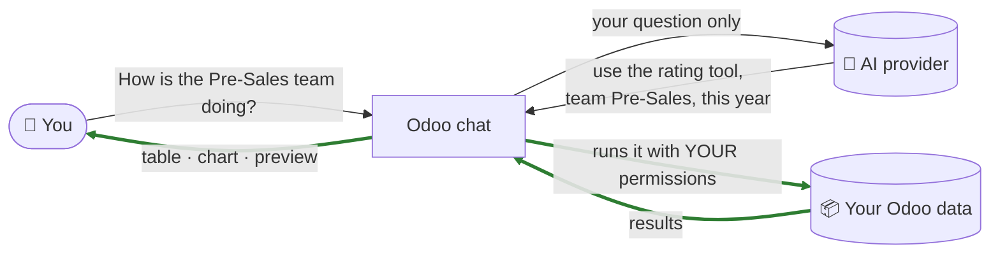
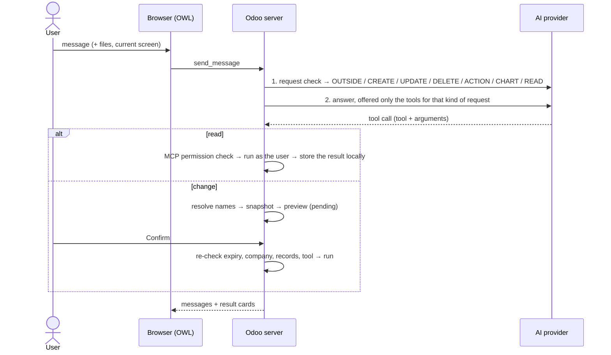

<div align="center">


# Odoo AI Assistant

### Ask Odoo in plain words. Get answers inside Odoo. Your data stays yours.


</div>

---

## ✨ In 30 seconds

A chat window built into Odoo. You type a question, in any language, and Odoo answers with **real
tables, charts and previews** taken from your own data.

> 💬 *"Show opportunities that are rotting"* → a table of stuck deals
> 💬 *"Pie chart of opportunities by salesperson"* → a chart
> 💬 *"Who needs coaching this year, Marc or Mitchell?"* → a sales rating with a plain-words verdict
> 💬 *"Set the expected revenue of Cloud Migration to 50000"* → a preview with a **Confirm** button

**Three promises:**

| | |
|:---:|---|
| 🔒 | **Your records stay in Odoo.** The AI decides *what* to look up; Odoo looks it up and shows it only to you. |
| ✅ | **Nothing changes without your click.** Every create, update or delete is a preview you **Confirm** or **Cancel**. |
| 👤 | **It can only do what you can do.** Same permissions as your Odoo user — never more. |

---

## 🧭 Where to start

| I am a… | Read this |
|---|---|
| 🙋 **User** who wants to ask questions | [What can I ask?](#-what-can-i-ask) · [Using the chat](#-using-the-chat) |
| 👔 **Team lead or manager** | [How it works](#-how-it-works-in-one-picture) · [Is my data safe?](#-is-my-data-safe) · [Sales ratings](#-sales-ratings-who-needs-coaching) · [What it costs](#-what-it-costs) |
| 🛠️ **Administrator** setting it up | [Install](#-install-in-4-steps) · [Settings explained](#%EF%B8%8F-settings-explained) · [Troubleshooting](#-troubleshooting) |
| 💻 **Developer** | [For developers](#-for-developers) |

---

## 💬 What can I ask?

| You type | You get |
|---|---|
| *Which Odoo version is running?* · *What is inside the CRM app?* · *Where can I find CRM settings?* | A clear explanation, using **your** menus |
| *Find quotations for Acme* · *Show the details of contact Acme Corporation* | A **table** of records, with **‹ Previous / Next ›** for long lists |
| *Show the last five orders* | Exactly those 5 — *"Records 1–5 of 22"* |
| *Show opportunities with overdue activities* · *…that are rotting* | The matching records |
| *How many opportunities does each salesperson have?* | A **Salesperson · Count** table |
| *Chart opportunities by stage* · *Pie chart by salesperson* | A **chart**, with **Export as PDF / Excel** |
| *Show the history of opportunity Info about services* | Every note, email and change (stage, salesperson…) as a **Date · By · Type · What happened** table |
| *How is my sales team performing this year?* | A **sales rating** of every salesperson + who needs coaching |
| *Create an opportunity called Office chairs for Acme* · *Move Mobile App Development to Proposition* | A **preview** → you click **Confirm** |
| *What's in this PDF?* (with a file attached) | The file's contents explained |
| *Hi* · *Thanks* | A short friendly reply |
| *What is the capital of France?* | *"I can only assist with Odoo…"* |

> 💡 **Tip:** name things exactly as they appear in Odoo — *"opportunity **Cloud Migration**"*. If two
> records share a name, the assistant tells you and shows both, so you can pick one by its ID.

---

## 🧩 How it works, in one picture



**The AI is the planner. Odoo does the work.** 🟩 Green steps never leave Odoo.

| Step | Who | What happens |
|:---:|---|---|
| 1 | 🤖 AI | **Understands** your question, in any wording or language |
| 2 | 🤖 AI | **Chooses the right tool** and fills in the details — *"last month"* becomes 1–30 Sept |
| 3 | 📦 Odoo | **Checks** your permissions and the admin's rules, then fetches and calculates |
| 4 | 📦 Odoo | **Shows you** the table, chart or preview. The AI never sees it. |

The AI writes text only for **"how do I…?"** questions (from its Odoo knowledge) and — if an
administrator allows it — when **you** click **Share and continue** on a result to ask for an analysis.

---

## 🔒 Is my data safe?

| Question | Answer |
|---|---|
| Does the AI see my customers, deals or numbers? | **No.** Results are shown only to you. The AI is told *"a result was shown"*, not what it contained. |
| Can it change data on its own? | **No.** Every change is a preview. Only your **Confirm** click applies it — and Odoo re-checks it first. |
| Can it see more than I can? | **No.** It works with your own Odoo user rights. |
| Can an admin limit what the AI touches? | **Yes.** In **MCP Server → Available models**, per type of data: Read / Create / Update / Delete. |
| Are passwords, keys and system settings protected? | **Always.** They are off-limits, whatever the settings. |
| Can others read my chats? | **No.** Conversations are private to their owner. |
| Can the AI ever read my results? | Only if an admin enables sharing **and** you click **Share and continue** on that one result. |

> ⚠️ **Two honest notes.** What you **type** in the chat is sent to the AI provider — don't type
> confidential details. The API key is stored in Odoo's database (readable by administrators only) —
> protect your backups.

---

## 📊 Sales ratings: who needs coaching?

Ask *"How is my sales team performing this year?"*, *"How is the Pre-Sales team doing?"* or
*"Who needs coaching, Marc Demo or Mitchell Admin?"* and Odoo rates each salesperson against the
targets **you give in the question**, for example *"Rate my team this year: win rate 30%, revenue 50,000 a month,
deals closed within 30 days"*. If you don't say which targets to use, the AI asks you; it never invents them.

> **Needs coaching most: Mitchell Admin (score 0). Below target: Activities on time, Recent contact.
> Strongest: Marc Demo (score 40).**

| Salesperson | Closed deals | Win rate (target 30%) | Won revenue (target $ 471,458) | Days to close (target 30) | Activities on time (target 90%) | Recent contact (target 100%) | Score (0–100) | Needs attention |
|---|---|---|---|---|---|---|---|---|
| Marc Demo | 3 | 67% | $ 4,000 | 4 | 0% | 0% | 40 | Won revenue, Activities on time, Recent contact |

**What each measure means**

| Measure | In plain words |
|---|---|
| **Win rate** | Of the deals closed in the period, how many were won |
| **Won revenue** | Value of deals won, vs. a monthly target scaled to the period (only the part that has happened) |
| **Days to close** | How fast won deals were closed — fewer is better |
| **Activities on time** | Of the activities due in the period, how many were done by their deadline |
| **Recent contact** | Of the deals open at the end of the period, how many had an email, a logged note or a completed call/meeting shortly before |
| **Score** | A weighted average of the above, 0 to 100 |

- 🧮 **Calculated by Odoo, not by the AI** — the same data always gives the same answer, and nothing is sent out.
- 🎯 **Only what you ask for** — the table shows and scores just the measures you named.
- ⚖️ **Fair when you want it** — say *"at least 3 closed deals"* and win rate, revenue and days to close are shown but not scored below that, so one big deal can't decide a rating.
- 👀 **Respects permissions** — a salesperson who sees only their own deals sees only their own rating.
- 🧭 **Use it to start a conversation, not as a final verdict.** It only knows what is logged in Odoo: unlogged calls, territories, holidays or lead quality are invisible to it.

**What you can include in your question**

| Say | Example | If you don't say it |
|---|---|---|
| **Target per measure** | *win rate 30%*, *revenue 50,000 a month*, *close within 30 days*, *90% of activities on time*, *contact every 14 days* | The AI asks which measures and targets to use |
| **Weights** | *count revenue twice* | Every measure counts the same |
| **Minimum closed deals** | *at least 3 closed deals* | Scored from the first closed deal |
| **Team targets for revenue** | *use each team's invoicing target* | The revenue target you gave |
| **Owner at closing** | *credit deals to whoever closed them* | Credited to the current salesperson |

---

## 💰 What it costs

The module is free (LGPL-3). You pay your AI provider for what the chat uses.

| | |
|---|---|
| **Per question** | 2 small AI calls (a request check + the answer), plus a tiny one to name a new chat |
| **Typical size** | ~5,000 input tokens per question, much of it cached by providers at a lower price · short answers |
| **Your data** | Not sent → a 100-row result costs the same as a 1-row result |
| **In money** | On a paid "mini"/"flash"-class model: a fraction of a cent to a few cents per question (check your provider's prices) |
| **Free AI plans** | Work, but run out fast (often ~50 requests/day ≈ 15–25 questions) |
| **Tracking** | **AI Agent → Reporting → Usage** shows cost, calls, tokens and users per day, model and person |

---

## 🙋 Using the chat

| | |
|---|---|
| **Open it** | Click the 🪄 **magic wand** in the top bar (resize, minimise or go full screen) — or open the **AI Agent** app, or **Discuss → AI conversations** |
| **New chat** | The **+** button. Your past chats are listed on the left, with search and an **Unread** filter |
| **Attach a file** | **➕ → Attach Files** — PDF, Word, Excel, PowerPoint, images, text. (Scanned PDFs can't be read: they are pictures of text.) |
| **Speak** | **➕ → Voice Message** or **Alt + V**; your browser types what you say |
| **On a result card** | **Steps taken** shows what the assistant did · **Technical details** shows the raw result · **‹ Previous / Next ›** pages long lists |
| **On a change preview** | Read it, then **Confirm** or **Cancel**. Previews expire after 30 minutes. |

---

## 🚀 Install in 4 steps

**You need:** Odoo 19 Community (admin access) · the free [**MCP Server**](https://apps.odoo.com/apps/modules/19.0/mcp_server)
module (third-party, not included) · an API key from OpenAI, Anthropic, Google or OpenRouter.

1. **Copy** the `odoo_ai_assistant` and `mcp_server` folders into a folder on Odoo's **addons path**.
2. **Install the Python packages** with the Python that runs Odoo:

   ```bash
   pip install -r odoo_ai_assistant/requirements.txt                          # Linux / macOS
   C:\Odoo\venv\Scripts\pip install -r odoo_ai_assistant\requirements.txt     # Windows (example path)
   ```

3. **Restart** Odoo.
4. **Apps** → **Update Apps List** (developer mode) → search **Odoo AI Assistant** → **Activate**.

> 🔄 **Updating to a new version:** replace the folder → stop Odoo →
> `odoo-bin -c odoo.conf -d <your database> -u odoo_ai_assistant --stop-after-init` → start Odoo →
> users press **Ctrl + Shift + R**. Skipping the `-u` step after an update that adds settings causes errors.

---

## ⚙️ Settings explained

**Settings → AI Agent** (administrators only).

### Basics

| Setting | What it does | Example | Default |
|---|---|---|---|
| **Enable AI Agent** | The main switch for everyone | Untick during a provider outage → the chat disappears for all | Off |
| **AI provider · API Key · AI Model** | Which AI answers, and on whose account. Administrators can also switch the **AI Model** from the dropdown at the top of a conversation in Discuss; it changes this same setting, for everyone | OpenAI + your key + a "mini" model | — |
| **Refresh available models** | Reloads the provider's model list. For OpenRouter you can filter **Free / Commercial**; models that can't use Odoo's tools are hidden | A new model is released → click Refresh | — |
| **User access** | Per person: **Settings → Users → Access Rights → AI → AI Agent = Yes** | Sales staff Yes, warehouse No | No |

### What the AI may do

| Setting | What it does | Example | Default |
|---|---|---|---|
| **Configure AI Permissions** | The chat may search, count, chart and rate records the user can already open; Odoo shows the results, the AI never receives them | Off → it only explains how Odoo works | On |
| ↳ **Choose which Odoo data the AI may use** | Opens **MCP Server → Available models**: per type of data, allow Read / Create / Update / Delete | Contacts readable, Invoices not | — |
| **Changes with your approval** | The chat may prepare previews for you to Confirm (also enables **Attach Files**) | Off → read-only assistant | Off |
| **Let the AI see menu and screen names** | Shares menu names and field labels (never record values) so it can explain *your* screens | *"Go to CRM → Configuration → Settings"* | Off |

> 🧱 **All of these must say yes** for the chat to read something: the main switch · the user's AI access
> · *Configure AI Permissions* · the type of data allowed in MCP Server · the user's own Odoo rights.

<details>
<summary><b>Advanced settings (developer mode)</b></summary>

| Setting | What it does | Default |
|---|---|---|
| **Allow sharing results with the AI provider** | Adds **Share and continue** on result cards, so a user can ask the AI to analyse that one result | Off |
| **AI data requests per user per minute** | Protects Odoo from runaway requests (1–600) | 60 |
| **Maximum answer length (tokens)** | Upper limit for each AI answer (256–65,536) | 2,048 |
| **Provider timeout (seconds)** | How long to wait for the AI (10–600) | 60 |

</details>

---

## 🧯 Troubleshooting

| You see | What to do |
|---|---|
| No 🪄 in the top bar | Tick **Enable AI Agent**, set the user's **AI Agent = Yes**, reload |
| *"Select an available model in AI Settings first"* | Choose an **AI Model** and **Save** |
| HTTP **401 / 403** | The provider rejected the API key — paste a valid one |
| HTTP **429 … rate limit or usage quota** | The provider plan's limit is reached — wait, or use a paid plan |
| HTTP **503 … unavailable** | The provider is busy — retry, or choose another model |
| *"I can only assist with Odoo…"* for an Odoo question | Mention the app: *"…in CRM"* |
| *"More than one Lead is named …"* | Several records share that name — use the ID shown in the list |
| *"MCP does not permit read on …"* | Allow that type of data in **MCP Server → Available models** |
| *"Return to the original active company selection…"* | Select the same companies in the top bar as when the result was created, or ask again |
| *"This tool request expired…"* | Previews last 30 minutes — ask again |
| The assistant answers in text instead of showing a table | Rephrase more directly (*"Show…"*, *"How is the X team doing?"*). Free models do this more often |
| *"Style error"* or a broken screen after an update | Run the update with `-u` (see [Install](#-install-in-4-steps)), restart, **Ctrl + Shift + R** |

**Good to know:** charts show up to 50 groups · attached files are kept for one day · a shared result is
limited to 100,000 characters and 4 images · the assistant has no internet access.

---

<details>
<summary><b>📖 Words explained</b></summary>

| Word | Meaning |
|---|---|
| **AI provider** | The company running the AI (OpenAI, Anthropic, Google, OpenRouter) |
| **API key** | A secret password from the provider, so the module can use your account |
| **AI model** | A specific AI; models differ in quality, speed and price |
| **Token** | What providers charge by — roughly 4 characters of text |
| **MCP Server** | The Odoo module that gives AIs controlled, permission-checked access to Odoo data |
| **Tool** | One action the AI can ask Odoo to do: search, chart, rate, prepare a change… |
| **Preview** | A proposed change shown before anything is saved |
| **Share and continue** | A button that sends one result to the AI so it can analyse it (only if allowed) |
| **Developer mode** | **Settings** → bottom of the page → **Activate the developer mode** |

</details>

---

## 💻 For developers

<details>
<summary><b>How a message flows</b></summary>



</details>

<details>
<summary><b>Design decisions</b></summary>

| Decision | Why |
|---|---|
| Results stored locally; chat history sends the AI a placeholder | Record values never leak through history |
| Records, options and tags given by **name** | The AI can't know IDs; Odoo resolves each name to exactly one accessible record — at preview, also inside new lines — or refuses |
| Snapshot + digest on every preview, re-checked on Confirm | A change can't apply to records that moved since the preview |
| One request check offers only matching tools | Fewer wrong tool choices, smaller requests |
| Fixed instructions first, per-request data last | Providers can cache the prefix, cutting cost |
| Rules sent only when they apply (change rules, screen rules, settings names) | ~20% smaller instructions on read questions |
| Ratings and summaries computed in Odoo | Deterministic, explainable, private |
| Every model a tool reads goes through MCP Server's permission check | One switch for everything the AI may touch |
| OpenRouter models filtered by their published tool-calling capability | No model-name lists to maintain |
| All limits in `limits.py` | One place to tune; no magic numbers |

</details>

<details>
<summary><b>Project map</b></summary>

```
odoo_ai_assistant/
├── models/
│   ├── conversation.py   chat flow · request check · tool selection · history · files · paging
│   ├── providers.py      OpenAI / Claude / Gemini / OpenRouter · all AI instructions · model lists
│   ├── native_mcp.py     tools (history, sales ratings…) · previews & Confirm · name lookup · cards · audit
│   ├── tools.py          chart · app structure · screen details · version tools
│   ├── navigation.py     the user's apps, menus and screens
│   ├── mcp_bridge.py     read-only grouping for charts
│   ├── configuration.py  AI Settings · model catalogue · user access
│   ├── usage.py          usage log and dashboard
│   ├── discuss.py        keeps AI conversations private in Discuss
│   ├── formatting.py     safe Markdown rendering
│   ├── chart_export.py   PDF and Excel export of charts and tables
│   └── limits.py         every limit, lifetime, protected model and credential filter
├── static/src/           chat window · result cards · Discuss · usage dashboard
├── views/ · security/ · data/
└── i18n/                 translation template (odoo_ai_assistant.pot)
```

</details>

<details>
<summary><b>Where to change things</b></summary>

| To change | Go to |
|---|---|
| A limit, lifetime or cap | `models/limits.py` |
| Protected models / credential fields | `RESTRICTED_MODELS`, `RESTRICTED_MODEL_PREFIXES`, `CREDENTIAL_FIELD` in `limits.py` |
| The AI's instructions | `providers.py`: `_reply_once()` (answers), `classify_request()` (request check), `GREETING_INSTRUCTIONS`, `conversation_title()` |
| Which tools exist | `_BUILTINS` in `native_mcp.py` (data-changing tools always need Confirm) |
| The sales rating | `_rate_sales_executives()` in `native_mcp.py` (rules come from the question) |
| How cards look | `NativeToolRequest._payload()` in `native_mcp.py` · `static/src/visualization.xml` |
| Add an AI provider | `PROVIDERS`, `BASE_URLS`, then `_reply_once()`, `_tokens()`, `models()` in `providers.py` |

</details>

<details>
<summary><b>Workflow</b></summary>

```bash
odoo-bin -c odoo.conf -d <db> -u odoo_ai_assistant --stop-after-init   # after Python fields, XML or manifest changes
odoo-bin i18n export -c odoo.conf -d <db> odoo_ai_assistant             # refresh the translation template
```

- Restart Odoo after Python changes; **Ctrl + Shift + R** after JavaScript, templates or styles.
- Compile edited `.scss` with Odoo's libsass; wrap CSS `min()`/`max()` with mixed units in `unquote()`.
- Odoo 19 loads graph and pivot views from `web.assets_backend_lazy` — patches to them belong there.
- Server logs record request sizes and timings for every AI call, never message content.
- **Status:** verified with scripted checks and live tests against a real Odoo 19 database; an automated
  `tests/` folder is not committed yet.

</details>

---

<div align="center">

**LGPL-3** · see [LICENSE](LICENSE) · the required `mcp_server` module is distributed separately under its own license

</div>
