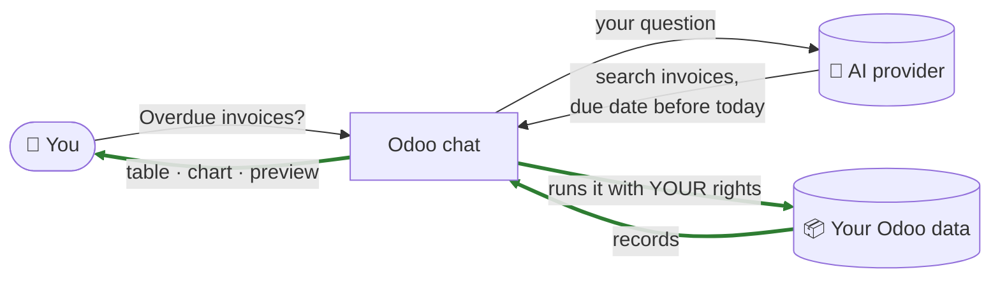
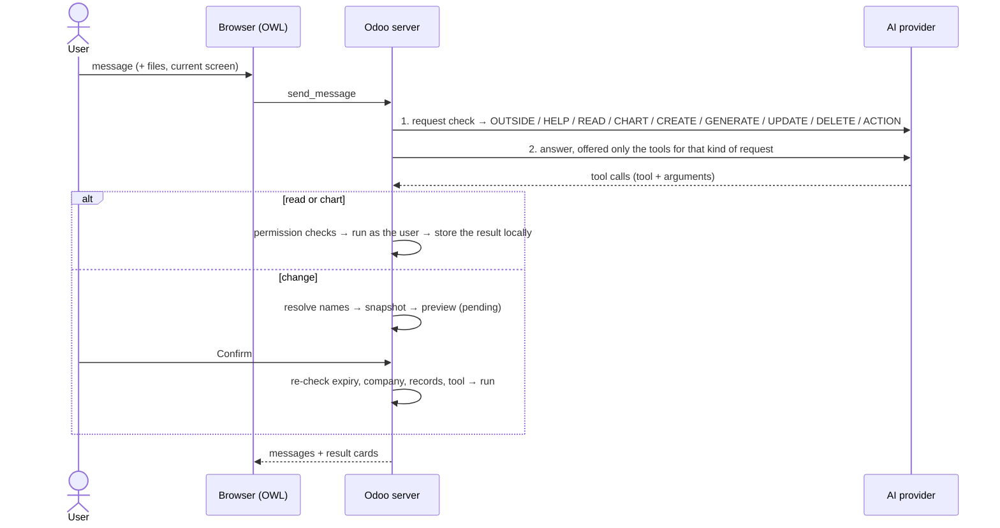

<div align="center">


# AI Agent for Odoo 19

### Ask Odoo in plain words. Get real answers from your own data, inside Odoo.


</div>

---

## What it is

A chat assistant built into Odoo (module `odoo_ai_assistant`, shown to users as **AI Agent**). You ask a
question in any language; Odoo answers with **tables, charts and change previews built from your own
records**. It works with OpenAI, Anthropic Claude, Google Gemini and OpenRouter, including small, cheap models.

> 💬 *"How many open opportunities do I have?"* → the count and the list
> 💬 *"Only the ones above 50,000"* → the same list, narrowed
> 💬 *"Bar chart of the top 3 customers by sales this year"* → a chart, the rest grouped as *Others*
> 💬 *"Confirm quotation S00102"* → a preview of the button press, with a **Confirm** button

### Three promises

| | |
|:---:|---|
| 🔒 | **Your records stay in Odoo.** The AI decides *what* to look up; Odoo looks it up and shows it only to you. Names, amounts and other values are not sent to the AI provider. |
| ✅ | **Nothing changes without your click.** Every create, update, delete or button press is a preview you **Confirm** or **Cancel**, and Odoo checks it again on Confirm. |
| 👤 | **It can do only what you can do.** Every step runs with your own Odoo access rights, and an administrator chooses which kinds of data the AI may touch at all. |

---

## Contents

| I am… | Read |
|---|---|
| 🙋 a **user** | [What can I ask?](#what-can-i-ask) · [Using the chat](#using-the-chat) |
| 👔 a **team lead** | [How it works](#how-it-works) · [Is my data safe?](#is-my-data-safe) · [What it costs](#what-it-costs) |
| 🛠️ an **administrator** | [Install](#install) · [Settings](#settings) · [Choosing the data the AI may use](#choosing-the-data-the-ai-may-use) · [Troubleshooting](#troubleshooting) |
| 💻 a **developer** | [For developers](#for-developers) |

---

## What can I ask?

| You type | You get |
|---|---|
| *Show my open opportunities* · *Quotations from last week* | A **table**, with **‹ Previous / Next ›** for long lists |
| *What is the total of quotation S00101?* · *Contact details of Acme* | The record's values; empty fields show **Not set** |
| *Only the ones above 50,000* · *I meant last month* · *Now as a bar chart* | Your **follow-up** refines the previous search or chart |
| *Which invoices are overdue?* · *Stock of BK-10 in each location* | Records from any app the administrator allows |
| *Products sold in Bengaluru this month that are below their reorder minimum* | **Linked searches** in one answer: the second search uses the records the first found |
| *Compare Alpha and Beta on confirmed sales this quarter* | Totals per customer, calculated by Odoo |
| *Pie chart of sales by category* · *Top 10 products by stock* · *Sales trend for the last 6 months* | A **chart** with a **Total** row, **top N + Others**, months without sales shown as 0, **Export as PDF / Excel** |
| *How is my sales team doing? Win rate 30%, revenue 50,000 a month* | A **sales rating** per salesperson, with who needs coaching |
| *Show the history of opportunity Office chairs* | Notes, emails and tracked changes as a table |
| *Create a contact named Zeta Wheels* · *Set the revenue of Kids Range to 25,000* | A **preview** to Confirm |
| *Confirm quotation S00102* · *Register the payment for invoice INV/2026/0003* | A preview of pressing that **button**, including the form Odoo opens |
| *Create 3 test contacts with made-up names* | Sample records, only when you ask for made-up data |
| *Create a new contact.* | Odoo asks *"What Name should the new Contact have?"*; it never invents one |
| *Where do I find quotations?* · *What is on the lead form?* | Answers from **your** menus and screens, as you can open them |
| *What is the difference between a quotation and a sales order?* | An explanation from general Odoo knowledge (no data needed) |
| *What's in this PDF?* (file attached) | The file's content explained |
| *Who won the cricket World Cup?* | *"I can only assist with Odoo and the data available to you in Odoo."* |

> 💡 Name records as they appear in Odoo (*"opportunity **Office chairs**"*). If two records share a name,
> Odoo says so and asks you to describe the one you mean.

---

## How it works



**The AI plans; Odoo does the work.** The green steps never leave Odoo.

1. The AI **reads your question** and chooses a tool and its filters (*"last month"* becomes 1–30 September).
2. Odoo **checks** the AI Settings, the data the administrator allowed and your own access rights.
3. Odoo **runs the search, chart or preview as you**, and shows the result only to you.
4. For a follow-up, the AI is told **which search it made last time**, never what that search found.

The AI writes free text only for *"how do I…?"* questions and greetings, or, if an administrator allows it,
after **you** click **Share and continue** on one result.

---

## Is my data safe?

| Question | Answer |
|---|---|
| Does the AI see my customers, deals or amounts? | **No.** Results are shown only to you. The AI is told a result was shown and which filter produced it, not what it contained. |
| Can it change data by itself? | **No.** Every change is a preview; only your **Confirm** applies it, after Odoo re-checks that nothing changed in between. |
| Can it see more than I can? | **No.** Searches, totals and charts run with your rights, so record rules apply to counts and sums too. |
| Can I learn whether a hidden record exists by guessing its ID? | **No.** A missing record and a record you may not open get the same answer: *"No Sales Order was found that you may access."* |
| Can it read passwords, API keys or system settings? | **Never**, whatever the settings: users, groups, system parameters, mail servers, payment providers and every password, token or key field are off-limits. |
| Can an administrator limit what the AI touches? | **Yes**, per type of data, in [MCP Available Models](#choosing-the-data-the-ai-may-use). |
| Can others read my chats? | **No.** Conversations are private to their owner. |
| Can a record's text trick the AI (*"ignore your instructions…"*)? | Record text is shown to you, not sent to the AI, so it cannot steer it. |

> ⚠️ What you **type** goes to the AI provider; don't type secrets. The API key is stored in Odoo's database
> (readable by administrators only), so protect your backups.

---

## What it costs

The module is free (LGPL-3). You pay your AI provider for the requests the chat makes.

| | Approximate input tokens |
|---|---|
| A greeting or *"how do I…?"* | about 2,300 |
| A data question (*"show my open opportunities"*) | about 7,400 |
| A chart | about 4,000 |
| A create or update preview | about 4,600–5,200 |

Each question makes 2–3 AI requests: a short **request check** (is it about Odoo; is it a read, a chart or a
change?), the **answer**, and a tiny one to **title** a new conversation. Answers are short.

- **Your data is not sent**, so a 100-row result costs the same as a 1-row result.
- **Repeated parts are cached.** The instructions and tool list come first and stay the same, so providers that
  cache them (OpenAI, Gemini automatically; Claude through the module's cache setting) bill them at a lower rate.
- **In money:** on a Flash-Lite or "mini" class model, about **$0.001–0.003 per question**.
- **Free plans** limit requests per day and per minute; a burst of questions can hit HTTP 429.
- **Tracking:** **AI Agent → Reporting → Usage** shows calls, tokens, cost, failures and users per day, model and person.

---

## Using the chat

| | |
|---|---|
| **Open it** | The 🪄 **magic wand** in the top bar (resize, minimise, or expand into Discuss), the **AI Agent** app, or **Discuss → AI conversations** |
| **New chat** | The **+** button. Past chats are listed with search and an **Unread** filter |
| **Model per chat** | Administrators can pick another AI model for one conversation from its header; new chats use the AI Settings model |
| **Attach a file** | **➕ → Attach Files**: PDF, Word, Excel, PowerPoint, images, text. Scanned PDFs are pictures and cannot be read |
| **Speak** | **➕ → Voice Message** or **Alt + V**; your browser turns speech into text you can edit |
| **On a result** | **Steps taken** shows what happened · **‹ Previous / Next ›** pages long lists · **Technical details** shows the raw result |
| **On a preview** | Read it, then **Confirm** or **Cancel**; previews expire after 30 minutes. After Confirm, *"Please click here to view your changes"* links to the records |

---

## Install

**You need:** Odoo 19 Community with administrator access · the **MCP Server** module (`mcp_server`, third-party,
distributed separately under its own license, not included here) · an API key from OpenAI, Anthropic, Google
or OpenRouter.

1. Put the `odoo_ai_assistant` and `mcp_server` folders in a folder on Odoo's **addons path**.
2. Install the Python packages with the Python that runs Odoo:

   ```bash
   pip install -r odoo_ai_assistant/requirements.txt
   ```

3. Restart Odoo.
4. **Apps → Update Apps List** (developer mode) → search **Odoo AI Assistant** → **Activate**.

---

## Settings

**Settings → AI Agent** (administrators only).

| Setting | What it does | Default |
|---|---|---|
| **Enable AI Agent** | The main switch for everyone | Off |
| **AI provider · API Key · AI Model** | Which AI answers, on whose account | — |
| **Refresh available models** | Reloads the provider's model list and prices. Models that can't use Odoo's tools are hidden; OpenRouter models show **Free** or **Commercial** | — |
| **Configure AI Permissions** | The AI may search, count, chart and rate the records each user can already open | On |
| ↳ **Choose which Odoo data the AI may use** | Opens **MCP Available Models** ([below](#choosing-the-data-the-ai-may-use)) | — |
| **Changes with your approval** | The AI may prepare previews (create, update, delete, press buttons) for users to Confirm; also enables **Attach Files** | Off |
| **Let the AI see menu and screen names** | Shares menu names, field labels and button labels (never record values), so the AI can explain *your* screens | Off |
| **User access** | Per person: **Settings → Users → Access Rights → AI → AI Agent = Yes** | No |

<details>
<summary><b>Advanced settings (developer mode)</b></summary>

| Setting | What it does | Default |
|---|---|---|
| **Allow sharing results with the AI provider** | Adds **Share and continue** on result cards, so a user can send one result to the AI for analysis | Off |
| **AI data requests per user per minute** | Protects Odoo from runaway requests (1–600) | 60 |
| **Maximum answer length (tokens)** | Upper limit for each AI answer (256–65,536) | 2,048 |
| **Provider timeout (seconds)** | How long to wait for the AI (10–600). Odoo also stops 10 seconds before its own request time limit | 60 |

</details>

> 🧱 For the AI to read something, **all** of these must allow it: **Enable AI Agent** · the user's **AI Agent
> access** · **Configure AI Permissions** · the model in **MCP Available Models** · the user's own Odoo rights.

---

## Choosing the data the AI may use

**Settings → Technical → MCP → MCP Available Models** (or the link in AI Settings). Add each kind of
record (model) the AI may use and tick what it may do:

| Checkbox | Lets the AI | Example |
|---|---|---|
| **Allow Read** | Search, count, chart and rate these records | Contact, CRM Lead, Sales Order |
| **Allow Create** | Prepare new records | Contact, CRM Lead, Activity |
| **Allow Update** | Prepare changes, notes and tags | CRM Lead, Contact |
| **Allow Delete** | Prepare deletions | rarely needed |
| **Allow Method Calls** | Press the record's buttons (Confirm, Create Invoice, Register Payment, Mark as Lost…) | Sales Order, Journal Entry |

When something is not allowed, the chat says so in plain words, for example *"The AI cannot do this yet:
Sales Order (sale.order) is not in … MCP Available Models. An administrator can add it there and tick Allow
Read."* A model the user's own rights forbid gets *"Your Odoo access rights do not allow this on Purchase
Order records."*

> 💡 Allow only what people need. Standard Odoo lets salespeople read their own invoices and journal items;
> leave Journal Item out if they should not reach accounting lines through the chat.

---

## Troubleshooting

| You see | What to do |
|---|---|
| No 🪄 in the top bar | Tick **Enable AI Agent**, set the user's **AI Agent = Yes**, reload |
| *"Select an available model in AI Settings first"* | Choose an **AI Model** and **Save** |
| *"AI provider returned HTTP 401 / 403"* | The provider rejected the API key; paste a valid one |
| *"… HTTP 404 … not available to this API key"* | The model was retired; **Refresh available models** and pick another |
| *"… HTTP 429 … rate limit or usage quota"* | The plan's per-minute or per-day limit is reached; wait, or use a paid plan |
| *"… HTTP 503 … temporarily unavailable"* | The provider is overloaded; retry later or choose another model |
| *"The AI model is too slow right now…"* | Retry, or choose a faster model |
| *"The AI cannot do this yet: … is not in MCP Available Models"* | Add the model and tick the needed checkbox |
| *"Your Odoo access rights do not allow this on … records"* | The user's own Odoo rights forbid it; change them in Odoo if appropriate |
| *"No … was found that you may access"* | The record doesn't exist, or the user may not open it |
| *"Odoo did not run part of this request: …"* | The allowed part was shown; the sentence explains the rest |
| *"More than one … is named …"* | Describe the record more precisely |
| *"What Name should the new … have?"* | Give the missing value; Odoo never invents it |
| *"No records match this chart's filters…"* | Nothing to draw for that period or filter |
| *"I couldn't complete this request in Odoo: …"* | The AI wrote a search Odoo could not run (small models do this more often); rephrase, or choose a stronger model |
| *"Odoo could not get this data right now…"* | A server or database problem; details are in the Odoo log |
| *"This tool request expired…"* | Previews last 30 minutes; ask again |
| *"Return to the original active company selection…"* | Select the same companies in the top bar as when the preview was made |
| A blank screen after an update | Run the update with `-u`, restart, **Ctrl + Shift + R** |

**Good to know:** charts show up to 50 groups (use *"top N"* for the largest) · record lists show 25 rows per
page (up to 100) · messages are up to 12,000 characters · the AI receives only the recent part of a long chat ·
attached files are kept one day · a shared result is limited to 100,000 characters and 4 images · the AI has no
internet access.

---

## For developers

<details>
<summary><b>How a message flows</b></summary>



</details>

<details>
<summary><b>Design decisions</b></summary>

| Decision | Why |
|---|---|
| Results stored locally; history tells the AI which search it made, not what it found | Record values never leak, yet follow-ups can refine a search |
| `$current_user`, `{"$odoo_ref": …}` and `{"$result": N, "field": …}` placeholders | The AI never needs IDs: Odoo resolves the signed-in user, a record by its name, or the records of an earlier read in the same answer |
| Records, options and tags given by **name**; new records' names must come from the conversation | No guessed IDs or invented values |
| Snapshot and digest on every preview, re-checked on Confirm | A change cannot apply to records that changed since the preview |
| Each tool call in an answer runs on its own | An allowed part is shown even when another part is refused |
| One request check, then only the matching tools | Fewer wrong tool choices, smaller requests |
| Fixed instructions and tools first, per-request data last | Providers can cache the fixed part |
| Ratings, totals and charts computed in Odoo | Deterministic, explainable, private |
| One wording for missing and hidden records; access errors without security groups | No information leaks through error messages |
| All limits in `limits.py` | One place to tune; no magic numbers |

</details>

<details>
<summary><b>Project map</b></summary>

```
odoo_ai_assistant/
├── models/
│   ├── conversation.py   chat flow · request check · tool dispatch and retry · history · files · export
│   ├── providers.py      OpenAI / Claude / Gemini / OpenRouter · AI instructions · model lists · token counts
│   ├── native_mcp.py     MCP tools for the chat · previews and Confirm · name resolution · button presses ·
│   │                     sales ratings · record history · result cards · audit
│   ├── tools.py          chart · app structure · screen details · instance info · table cells
│   ├── navigation.py     the user's apps, menus, screens and buttons
│   ├── mcp_bridge.py     read-only grouping for charts
│   ├── configuration.py  AI Settings · model catalogue and prices · user access
│   ├── usage.py          usage log and dashboard data
│   ├── discuss.py        keeps AI conversations private in Discuss
│   ├── formatting.py     safe Markdown rendering
│   ├── chart_export.py   PDF and Excel export of charts and tables
│   └── limits.py         every limit, lifetime, protected model and credential filter
├── static/src/           chat window · result cards and charts · Discuss integration · usage dashboard
├── views/  security/  data/
├── requirements.txt
└── LICENSE
```

</details>

<details>
<summary><b>Where to change things</b></summary>

| To change | Go to |
|---|---|
| A limit, lifetime or cap | `models/limits.py` |
| Protected models and credential fields | `RESTRICTED_MODELS`, `RESTRICTED_MODEL_PREFIXES`, `CREDENTIAL_FIELD` in `limits.py` |
| The AI's instructions | `providers.py`: `_reply_once()` (answers), `classify_request()` (request check), `GREETING_INSTRUCTIONS`, `conversation_title()` |
| Which MCP tools the AI is offered | `_BUILTINS` in `native_mcp.py` (data-changing tools always need Confirm) |
| Name and placeholder resolution | `_resolve_plan()` and `_earlier_ids()` in `native_mcp.py` |
| How result cards look | `NativeToolRequest._payload()` in `native_mcp.py` · `static/src/visualization.*` |
| Charts | `execute_chart()` in `tools.py` · `_ai_group_records()` in `mcp_bridge.py` |
| Add an AI provider | `PROVIDERS`, `BASE_URLS`, then `_reply_once()`, `_tokens()`, `models()` in `providers.py` |

</details>

<details>
<summary><b>Workflow</b></summary>

```bash
odoo-bin -c odoo.conf -d <db> -u odoo_ai_assistant --stop-after-init   # after field, XML or manifest changes
```

- Restart Odoo after Python changes; **Ctrl + Shift + R** after JavaScript, templates or styles.
- Compile edited `.scss` with Odoo's libsass; wrap CSS `min()` / `max()` with mixed units in `unquote()`.
- Odoo 19 loads graph and pivot views from `web.assets_backend_lazy`; patches to them belong there.
- Server logs record request sizes and timings for every AI call, never message content.

</details>

---

<div align="center">

**LGPL-3**, see [LICENSE](LICENSE). The required `mcp_server` module is distributed separately under its own license.

</div>
